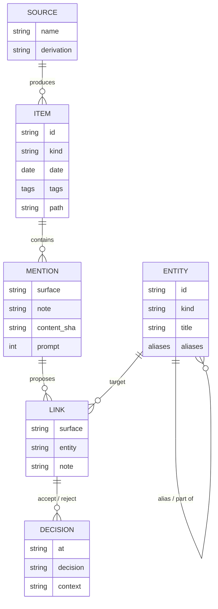

# Conceptual data model

One graph, many sources. Every fact records where it came from (`source`) and how it was produced (`derivation`). Field names below are the real ones in the vault and in OpenLabTwin (OLT).

## Research question

RQ: In a personal knowledge system fed by human, machine and institutional sources, does one provenance-aware Item model with one Decision log (accept, defer, dismiss, ignore) make sources linkable and attention measurable, and does the system improve from those decisions over time, compared with per-source silos?

Framing:

- mixed-initiative interaction (Horvitz 1999): the machine proposes, the human decides, and ignoring is a decision too.
- attention is the scarce resource (triage cost).
- boundary objects (Star and Griesemer 1989): OLT places and items are shared by the institution and the person.

## Entities

| Entity | In TyLog | In OLT |
|---|---|---|
| Item | a `.typ` note: daily, note, article, research, idea, screenshot (OCR), audio (ASR transcript) | `activities`, `lessons`, `ideas` |
| Entity | a note of kind person, organization, place, website, event or project; custom kinds are allowed and the lab export adds equipment. Marker pages and tags promoted to graph concepts also act as entities | `people`, `places`, `items`, `assets` |
| Mention | a span in an Item (`_system/enrich/mentions/*.json`) | an activity's note or purpose text |
| Link | the resolved reference (`#tylog.link`) | `activity_items`, `movements` |
| Decision | `_system/decisions/*.jsonl` (Incoming) and `_system/enrich/feedback/*.jsonl` (link review: `at`, `decision`, `surface`, `entity`, `note`, `context`, `proposed_by`, `confidence` when known) | `movements` (append-only), `audit_log` |

## Source and derivation

| Source | Produces | Derivation |
|---|---|---|
| Typed text (daily, notes) | Items | typed |
| Screenshot OCR | screenshot Items: category, tags, keywords | extracted |
| Audio ASR | transcript inside an audio Item | extracted |
| LLM enrichment (day notes, voice notes, screenshots; never articles) | Mentions, keywords, loan proposals, suggested Links | suggested; exact matches applied as `auto`, the rest confirmed or rejected |
| OLT export (`export_tylog.py`) | place, equipment and professor notes in `notes/labs/inventory/`, id = place code, asset tag or `lab-person-<id>` | institutional |
| OLT connector (Supabase) | requested bookings and new ideas in Incoming | institutional |
| Calendar (ICS) | event Items | imported |
| Contacts | person Entities | imported |

## Attention and Decision

Every Item has an attention state: new, kept, acted, archived. This is separate from domain progress such as task todo/doing/done or article reading. Old values map on read: screenshot inbox maps to new, `idea` new maps to new, and `idea` approved maps to kept. Screenshot kept/acted/archived and `idea` archived map to themselves.

One Decision row is `{at, device, item, source, action, target, context}`. Actions: seen, added-to-today, scheduled, accepted, rejected, dismissed, ignored. Rows live in `_system/decisions/<device>.jsonl`. Decisions in `_system/enrich/feedback` and `_system/enrich/shown` are read too.

External Items (OLT, Microsoft) are cached outside the synced vault and become a note only when the user acts.

## Knowledge states and provenance

ADR 0002 defines one status for every fact (link, mention, tag) and vocabulary item (tag, entity kind, cluster): proposed, accepted, rejected, auto, obsolete. In the code, link decisions record `proposed_by` (`llm:<model>` or `auto`) and `confidence` when known. The LLM only proposes. The resolver applies an exact, unambiguous match by itself and records it as `auto`. Cluster merges, splits and renames are proposals in Incoming. Tags and kinds change only by the user's own edit. There is no `contested` state. See [docs/adr/0002-knowledge-states.md](../adr/0002-knowledge-states.md).

## Rules

1. An external Entity (`source: openlabtwin`) is read-only in TyLog; edits go through OLT's API and its own access rules. Lab equipment, places and professors are exported into the vault as notes (`notes/labs/inventory/`, id = asset tag, place code or `lab-person-<id>`). The export overwrites them, and by policy TyLog does not edit them; loans recorded in TyLog become OLT movements through the lab bridge ([ADR 0003](../adr/0003-lab-equipment-identity-and-typed-loans.md)).
2. A suggested Link is final only after a Decision: the user's accept, or an `auto` decision for an exact match. The resolver learns from the decision ledger.
3. The graph can hide or show each source.
4. Secrets (tokens, API keys) are not part of the model; they stay per device.

## What the thesis measures

- Accept rate of suggested Links over time (`tool/enrich_learning.py`).
- Decision latency per source.
- Ignore rate per source.
- Gold set: 100-200 hand-labelled mentions, resolver with and without the Decision ledger.
- Coverage: share of Items per source that carry at least one confirmed Link.
- Novelty claim to test: one personal graph that mixes sources and tracks provenance links better over time than per-source silos.
