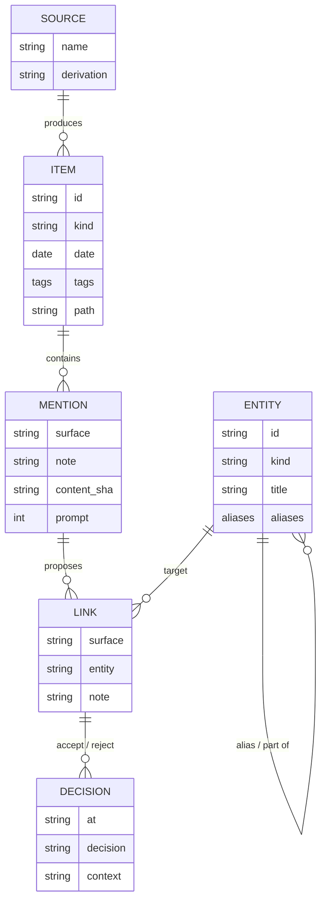

# Conceptual data model

One graph, many sources. Every fact records where it came from (`source`) and how it was produced (`derivation`). Field names below are the real ones in the vault and in OpenLabTwin (OLT).

## Entities

| Entity | In TyLog | In OLT |
|---|---|---|
| Item | a `.typ` note: daily, note, screenshot (OCR), audio (ASR transcript), article, event | `activities`, `lessons` |
| Entity | a note of kind person, place, project, concept or marker | `people`, `places`, `items`, `assets` |
| Mention | a span in an Item (`_system/enrich/mentions/*.json`) | an activity's note or purpose text |
| Link | the resolved reference (`#tylog.link`) | `activity_items`, `movements` |
| Decision | `_system/enrich/feedback/*.jsonl` (`at`, `decision`, `surface`, `entity`, `note`, `context`) | `audit_log` |

## Source and derivation

| Source | Produces | Derivation |
|---|---|---|
| Typed text (daily, notes) | Items | typed |
| Screenshot OCR | screenshot Items: category, tags, keywords | extracted |
| Audio ASR | transcript inside an audio Item | extracted |
| LLM enrichment | Mentions and suggested Links | suggested, then confirmed or rejected |
| OLT (Supabase) | external Entities, keyed by place code or uuid | institutional |
| Calendar (ICS) | event Items | imported |
| Contacts | person Entities | imported |

## Rules

1. An external Entity (`source: openlabtwin`) is read-only in TyLog; edits go through OLT's API and its own access rules.
2. A Link is never final until a Decision accepts it; the resolver uses accepted Decisions to improve.
3. The graph can be filtered by source; clusters can be grouped by source.
4. Secrets (tokens, API keys) are not part of the model; they stay per device.

## What the thesis measures

- Accept rate of suggested Links over time (`tool/enrich_learning.py`).
- Gold set: 100-200 hand-labelled mentions, resolver with and without the Decision ledger.
- Coverage: share of Items per source that carry at least one confirmed Link.
- Novelty claim to test: one personal graph that mixes sources and tracks provenance links better over time than per-source silos.
